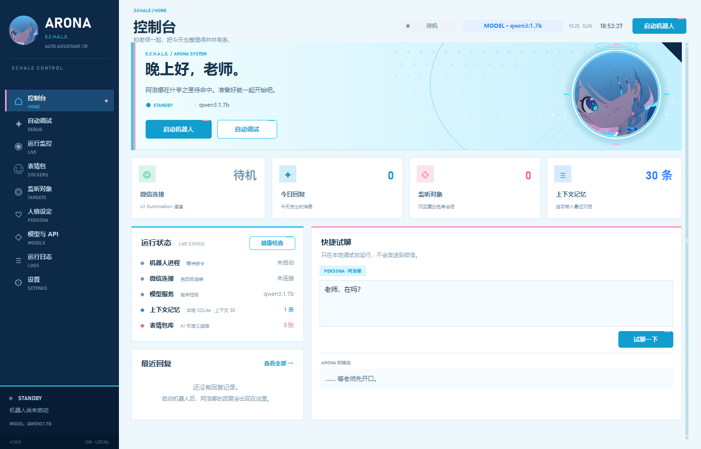

# ARONA · 什亭之匣微信助手



Windows 桌面微信自动回复机器人，默认人格是《蔚蓝档案》的**阿洛娜（Arona）**。  
界面使用蓝白、青色与粉色的 Blue Archive 风格，图标来自你提供的阿洛娜图片。

> 这是一个本地个人辅助工具，不是腾讯或《蔚蓝档案》官方产品。请只在你本人有权操作的设备、账号和会话中使用。

## 本次更新

- 本地模型切换为 **`qwen3:1.7b`**，不下载任何新模型。
- 默认发送 `think: false` 关闭思考过程，并启用精简提示词。
- 修复模型页「使用 / 测试」按钮的 `ToastManager is not callable` 异常。
- 新增消息发送者与发送方向识别：只回复 `in` 入站消息；阿洛娜自己的回声和老师手动输入都只作为上下文/直接忽略，绝不触发回复。
- 新增微信 4.1.15 兼容后端 `wechatauto`（本地数据库监听 + UIA 发送，OCR/截图关闭），并移除了所有 wxauto / wxautox 适配器与依赖。
- 修复低完整性 `.venv` 导致 `wechatauto` 报“未检测到 Weixin.exe”的问题：启动脚本会自动把 Python 启动器修复为 Medium 完整性。
- 新增「本地训练」页面：上传资料建立本地知识库，回复时自动检索；这是 RAG 知识训练，不修改模型权重。
- 修复阿洛娜自称“老师”的问题：提示词、历史消息角色标签和输出自检三层约束；自称固定为“阿洛娜/我”，对方统一称呼为“微信昵称+老师”，例如“赵军情老师”。
- 修复模型把表情包写成 `[挥手]（同时发送了表情包「挥手问候」）` 却不发送的问题：现在支持标准标签、裸表情包名和中文说明三种格式，并会清理说明文字。
- 修复第三方 OpenAI 兼容接口“模型不在列表”的误判：`/models` 仅作参考，程序会实际调用聊天接口验证，并保留用户填写的模型别名（例如 DeepSeek 的 `deepseek-chat`）。
- 修复停止机器人按钮一直显示“停止中”而不响应的问题：启动/停止完成后会清除按钮 busy 状态，并增加 20 秒看门狗。
- 修复启动后日志突然消失：`wechatauto` 导入时会清空根日志 handler，现已在导入后恢复 ARONA 日志。
- 新增启动时自动连接、控制台未读会话提示，以及启动/停止看门狗。
- 回复流程改为“先理解消息 → 再检索训练资料 → 能用的才自然融入，否则自己回答”；新增去 AI 腔和单条消息 23 字限制。
- 新增对方图片理解：本地解密图片，视觉模型生成描述，描述计入上下文与 Token 统计。
- 群聊新增「@ 必回复」和「未 @ 概率回复」开关，概率可在设置页调整。
- v1.0.2：每个群独立回复概率；群聊 @ 范围开关（登录昵称/仅阿洛娜）；管理员名单；单个群清空上下文；普拉娜人格；超长上下文定时摘要。
- v1.0.3：基沃托斯新闻每天早上 06:50 自动搜集文章资讯，分国服/日服/国际服发送到指定群；可开关，关闭后不联网。
- v1.1.0：新增「监听与回复」页；测试对象按群设置新闻时间；消息时效、引用回复、标点替换、关键词触发。
- v1.1.1：引用回复精确引用被回复的消息；关键词只在确实对阿洛娜说话时触发。
- v1.2.0：接入 WecVoice-auto，阿洛娜可按概率发送微信语音气泡；可在「监听与回复」开关并调整概率。
- 新增 /admin 管理员指令系统：密码验证、上下文重置、调试信息、暂停/恢复回复、保存/撤销退出。
- 新增模型 Token 统计：记录收到/回复消息、模型名、输入/输出 Token；控制台新增累计 Token 栏；DeepSeek 配置额外显示人民币账户余额。
- 修复 `arona.log` 中记录的旧错误，新版日志从下一次启动重新写入。

---

## 功能

| 模块 | 能力 |
| --- | --- |
| 模型 | 本地 **Ollama**；任意 **OpenAI 兼容 API**（DeepSeek、硅基流动、Moonshot、OpenAI、自建网关）；离线演示模式 |
| 人格 | 默认阿洛娜；可新建、修改、删除角色；可设置语气、说话风格、核心设定、口癖、边界和示例对话 |
| 上下文 | 默认 30 条，最低 20 条；SQLite 本地保存；支持从微信同步最近聊天作为上下文 |
| 表情包 | 导入 / 修改 / 删除 / 启用 / 停用；AI 根据名称、情绪、标签、描述语义选择；支持自动追加 |
| 本地训练 | 上传 txt/md/json/jsonl/csv/docx/pdf；本地切分、FTS5 检索，回复时注入相关资料；不修改模型权重 |
| 监听 | 严格白名单；好友 / 群聊；群聊支持「@ 必回」和「未 @ 概率回复」；可设置上下文窗口、独立人格 |
| 调试 | 本地调试台不发送到微信；一键自动调试运行环境、数据库、模型、微信、白名单，并做 3 轮上下文测试 |
| 监控 | 实时运行状态、模型健康、微信连接、数据库、表情包数量、最近回复详情 |
| 日志 | 分级过滤、搜索、自动刷新、导出、打开日志目录 |
| 隐私 | API Key 使用 Windows DPAPI 加密；不截屏、不录屏、不注入微信进程、不调用 Codex 库 |
| 外观 | Blue Archive 风格侧栏、切角、光环、阿洛娜头像与图标；10 个功能页面 |

## 快速开始

### 1. 环境

- Windows 10 / 11 64 位
- Python **3.9–3.12** 64 位（推荐 [Python 3.12](https://www.python.org/downloads/)；安装时勾选 `Add python.exe to PATH`）
- Windows 微信桌面端，已登录并**打开主窗口**
- 可选：本地 [Ollama](https://ollama.com/)，或一个第三方 API Key

### 2. 启动

双击：

```text
启动 ARONA.bat
```

第一次启动会自动创建 `.venv`、安装 `Pillow` 和 4.1.15 兼容后端，随后打开界面。  
如果双击没有反应，改双击 `启动 ARONA（控制台）.bat` 查看错误。

> 微信 **4.1.15** 使用新的“数据库 + UIA”路线，不使用 wxauto。
> 首次启动会自动安装；如安装失败，可手动双击 `安装 4.1.15 后端.bat`。
>
> 请从桌面/文件资源管理器双击启动，不要从受限沙箱或代理的文件面板启动；
> 低完整性进程会看不到微信进程，启动脚本会自动修复 `.venv` 的 Python 完整性。

### 3. 配置模型

打开 **模型与 API**：

- **本地 Ollama**：默认配置已经指向本机已有的 `qwen3:1.7b`，地址 `http://127.0.0.1:11434`，**不需要重新下载模型**。
  - 默认 **关闭思考过程**（发送 `think: false`），并启用“精简提示词”，把人格、语气、边界和表情包目录压缩成更短的系统提示。
  - 只读取 `message.content` 的最终回复，不把思考内容发到微信；如果模型仍只返回思考内容，会明确报错，而不是把思考当回复发出去。
  - 如果 Ollama 报内存不足，在模型编辑里把 `num_ctx` 降到 2048，或关闭其他占内存的程序；程序本身不会下载或替换模型。
  - 这台机器是 CPU 推理时，首次加载仍可能需要几十秒；界面会保持可操作，运行日志会记录耗时。
  - 如果模型只输出思考内容，自动调试和运行日志会给出“提高 tokens / 关闭思考 / 换用非思考模型”的提示。
- **第三方 API**：新增配置，提供方选“OpenAI 兼容 API”，例如：
  - DeepSeek：`https://api.deepseek.com/v1`，模型 `deepseek-chat`
  - 硅基流动：`https://api.siliconflow.cn/v1`
  - Moonshot：`https://api.moonshot.cn/v1`
  - OpenAI：`https://api.openai.com/v1`
- 点击 **拉取模型列表**、**测试连接**，保存后设为当前模型。
- API Key 使用当前 Windows 用户的 DPAPI 加密保存在 `data/config.json`，不会出现在日志或界面中。

> 离线演示模式只用于检查界面、上下文和表情包流程，不是真正的大模型。

### 4. 添加监听对象并启动

1. 打开微信，停留在主界面。
2. 在 **监听对象** 输入微信聊天窗口显示的**完整名称**（备注名/群名，必须完全一致）。
3. 建议先用 **文件传输助手** 测试。
4. 回到控制台，点击 **启动机器人**。
5. 给对方发一条消息，观察 **运行监控** 的回复记录。

> 白名单之外的人不会收到任何自动回复。群聊中 @ 阿洛娜时默认必回复；未 @ 时按设置的概率回复。

### 5. 自动调试

打开 **自动调试** → **开始自动调试**：

- 检查 Python、数据目录、配置、SQLite、人格、表情包、隐私边界、模型、微信组件、微信客户端、实时监听、白名单。
- 勾选“3 轮上下文对话测试”后，会让模型先记住一个口令，再在第三轮询问，验证上下文是否生效。
- 报告会逐项列出通过、提示和失败原因。

调试台的对话**只写本地数据库，不会发到微信**。

---

## 表情包如何被“理解”

每张表情包有：名称、情绪、标签、画面描述。生成回复时，程序会把当前启用表情包的目录放进系统提示词，要求模型在合适时输出：

```text
[sticker:开心转圈]
```

程序解析标签、从本地文件发送图片，并把标签从文字里移除。模型没有主动选择时，会按配置的概率和情绪关键词做一次安全兜底；严肃、医疗、危险话题不会发表情包。

管理页支持：

- 导入 PNG / JPG / WEBP / GIF / BMP
- 替换图片
- 修改名称、情绪、标签、描述
- 启用 / 停用
- 删除索引和本地图片
- 把图片直接丢进 `data/stickers/` 后点“重新扫描”

示例表情包是项目自绘的阿洛娜 Q 版贴纸，可自由替换成你自己的图片。

---

## 上下文

- 默认 30 条，设置页可调；**硬性下限 20 条**。
- 每次回复会把该会话最近 N 条（用户 + 阿洛娜 + 导入的聊天）组装为模型消息。
- 数据保存在 `data/arona.db`，不会因为关闭程序丢失。
- “监听对象 → 同步上下文”可以通过数据库后端读取最近消息，作为本地记忆补充。
- 群聊中会保留发送者昵称，避免把不同群友当成同一个人。

### 发送者与发送方向

每条消息都会单独标记方向和来源：

| 方向 | 来源 | 行为 |
| --- | --- | --- |
| `in` | 好友 / 群友 | 只有这类消息会触发回复 |
| `out` | 阿洛娜自己发送的界面回声 | 直接忽略，不会重复写入或触发回复 |
| `out` | 老师本人从微信手动输入 | 写入上下文供后续理解，但**绝不触发回复** |

- 本地数据库会给手动消息记录 `"direction": "out"` 和 `"manual": true`。
- 私聊和群聊的入站消息都写成 `[昵称老师] …`（例如 `[赵军情老师] …`）；我本人手动发送的内容会写成 `[我本人手动发出，不是阿洛娜发送的] …`，模型不会把它当成自己的发言。
- 除 `attr` 外，还会用消息方向、发送者昵称和最近发送记录交叉判断，避免把机器人自己的消息误判成好友消息。
- 运行监控的「消息方向」一行会显示当前过滤状态。

---

## 图片理解

当对方发图片时，程序会：

1. 从微信本地缓存读取并解密图片，保存到 `data/images/incoming`；
2. 如果当前模型启用了「支持图片理解」，把图片压缩后交给视觉模型；
3. 把图片描述写入上下文，再按正常流程理解、检索训练资料、回复；
4. 图片理解消耗的 Token 也会计入控制台「TOKEN 消耗」，并在日志中记录。

设置：

```text
模型与 API → 编辑模型 → 支持图片理解
```

- 当前 DeepSeek `deepseek-chat` 配置已启用，实测可以直接读图；
- 本地 `qwen3:1.7b` 是纯文本模型，不能直接看图；要本地读图需要换成支持视觉的 Ollama 模型，再打开这个开关；
- 图片只在本机解密；如果当前模型是第三方 API，图片会发送到该 API 做理解；
- 动图会使用微信本地缩略图进行理解。

## 管理员指令系统

在「设置 → 管理员指令」可以查看和修改管理员密码。默认密码：

```text
arona-admin
```

建议首次使用后改掉。密码保存在本机 `data/config.json`，不会写入日志；发送密码时也不会把密码写入聊天记忆。

### 指令

| 指令 | 行为 |
|---|---|
| `/admin` | 回复「阿洛娜收到，请输入管理员密码:」；下一条消息必须是该会话中同一发送者的密码 |
| 密码正确 | 进入管理员模式，回复「已进入管理员模式」 |
| `/reset` | 清空当前会话上下文，回复「已清空当前聊天的上下文记忆」 |
| `/test` | 直接发送一条程序调试信息，不调用模型/API |
| `/off` | 暂停当前会话的智能回复一小时，回复「已暂时关闭回复一小时」 |
| `/start` | 恢复当前会话的智能回复；已在运行则回复「已经在运行了」 |
| `/end` | 询问是否保存；回复 `/yes` 保存并退出，回复 `/no` 撤销本次管理员指令并退出 |
| `/yes` | 保存管理员模式下的状态，回复「修改已保存」，再发送「已退出管理员模式」 |
| `/no` | 撤销本次会话中的清空/暂停等操作，回复「刚才的一切指令已失效」，再发送「已退出管理员模式」 |

### 安全与行为

- 管理员模式只接受**发送过 `/admin` 并输入正确密码的同一发送者**；其他会话和发送者都不能下指令。
- 管理员模式期间，机器人暂停所有会话的智能回复与 API/本地模型调用；`/test` 等管理员回复由程序直接发送。
- 指令识别使用原始消息文本，**不受「我的微信昵称」设置影响**；`@阿洛娜 /admin` 也能识别。
- 你本人在机器人所在的微信账号里**手动输入** `/admin`、密码和后续指令也可以进入/操作管理员模式；机器人自己发出的消息不会被当成指令。
- `/off` 只暂停当前会话，前端仍显示机器人在监听/回复；一小时后自动恢复并发送「已恢复回复」。
- 密码错误不会进入管理员模式；密码不会出现在日志或聊天上下文中。
- 管理员密码会从「导出无 Key 配置」中隐藏。

## 群聊回复规则

在「设置 → 回复行为」中可以分别控制：

| 开关 | 作用 |
|---|---|
| 群聊 @ 后必回复 | 消息里 @ 阿洛娜时，不受概率影响，直接回复 |
| 群聊未 @ 概率回复 | 未 @ 时按设定的概率决定是否回复；关闭后未 @ 一律不回复 |
| 未 @ 回复概率 | 0–100%，默认 30% |

行为组合：

```text
@ + @必回复开启              → 一定回复
未 @ + 概率回复开启 + 命中   → 回复
未 @ + 概率回复开启 + 未命中 → 只写入上下文
未 @ + 概率回复关闭          → 只写入上下文
@ + @必回复关闭              → 按未 @ 的概率规则处理
```

被 @ 且开启必回复时，会跳过普通概率和单会话冷却，但仍受「自动回复关闭」「免打扰时段」等总开关约束。

## 回复流程与说话风格

每次回复按以下顺序处理：

1. **理解消息**：清理 @、发送者前缀和引用标签，判断意图（提问/请求/问候/安慰/闲聊）、情绪，并在“它/这个/刚才/继续”等短句中使用最近上下文补全检索词；
2. **检索训练资料**：用理解后的检索词查询本地训练库；
3. **按需融入**：检索到的记忆会作为“你记得的事”提供，但可能有用也可能无关；回答只保留真正能用的一两句，没有能用的就自己回答；
4. **生成短回复**：像微信真人一样先接住意思/情绪，再给一句具体回应；
5. **输出清理**：去掉“作为 AI”“我理解你的意思”“希望这些建议对你有帮助”“总之/首先/其次”等客服腔；
6. **长度限制**：默认**整条消息最多 23 个字**；最多 2 句，每句也受 23 字上限保护。

设置页的「整条最多字」和「单句最多字」可以调整，默认都是 23。训练资料不会被大段复述，也不会在回复里提“资料/文件/检索”。

## 本地训练（知识库 / RAG）

入口：

```text
侧栏 → 本地训练
```

Ollama 本身**不提供权重微调接口**，所以这里实现的是可落地的本地知识训练：

1. 上传 `txt / md / json / jsonl / csv / docx / pdf`；
2. 文件复制到 `data/training/files`，在 `data/training.db` 中切分并建立 FTS5 索引；
3. 每次回复前，用当前消息检索最多 `top_k` 个相关片段；
4. 把片段注入系统提示词，模型据此回答；**原模型权重不变**。

实测支持中文和英文检索；PDF 需要 `pypdf`（已加入基础依赖），DOCX 使用标准库解析，不需要 Office。

### 使用

1. 打开「本地训练」；
2. 点击「上传文件」，选择资料；
3. 在「训练设置」确认启用，设置片段数和字符上限；
4. 在「测试检索」输入问题，确认能命中资料；
5. 启动机器人。

### 注意事项

- 目前没有做梯度微调/LoRA；它不会让模型文件变大，也不会改变 `qwen3:1.7b` 本体。
- 资料只保存在本机；如果模型配置的是第三方 API，命中的片段会发送到该接口，页面会显示提醒。
- 上传前请确认资料版权和隐私；不要在资料中放密码、验证码、身份证号等敏感信息。
- 大文件会被截断到约 200 万字符并切分；建议按主题拆成多个文件，检索更准确。

## 阿洛娜的自称规则

阿洛娜必须：

- 自称：**阿洛娜** 或 **我**；
- **私聊**：称聊天对方为 **微信昵称+老师**，例如「赵军情老师」；
- **群聊**：当前回复的群友用其**微信昵称+老师**；其他群友也各用昵称+老师，不直呼裸昵称、不单独叫“老师”；
- 绝不能把带“老师”的称呼当作自己。

程序从三层修正：

1. 系统提示词和人格核心设定里加入最高优先级的自称/称呼规则；
2. 历史消息统一用 `[昵称老师]`、`[阿洛娜]` 标注角色，避免模型把“老师”误当自己，也避免群聊里只叫昵称；
3. 输出清洗会修复高置信度的错误，例如：
   - `老师好开心` → `阿洛娜好开心`
   - `告诉老师吧` → `告诉我吧`
   - `老师会一直陪着老师` → `我会一直陪着老师`

如果模型仍然偶尔说错，重新启动机器人即可加载新提示词；旧上下文里的错误称呼也会被角色标签隔离。

## Token 统计与 DeepSeek 余额

### 日志

每次模型调用会在 `logs/arona.log` 记录：

```text
收到入站消息 · 会话 · 发送者 · 类型 · 内容
模型调用 · provider/model · 输入 1796 · 输出 13 · 本次合计 1809 · 累计 1809 tokens
已回复 会话 · 模型=openai/deepseek-chat · tokens 输入=1796 输出=13 本次=1809 · 1300 ms · 回复内容
```

调试台的模型调用也会记录输入/输出 Token，但不会计入微信发送日志。

### 控制台

控制台新增 **TOKEN 消耗** 一栏：

- 累计总 Token；
- 输入 / 输出 Token；
- 今日 Token 与今日调用次数；
- 当前 DeepSeek 配置的账户余额（折算人民币）。

余额查询使用 DeepSeek 官方 `/user/balance` 接口，仅对 `api.deepseek.com` 配置有效。CNY 直接显示 `¥34.68`；USD 按 `1 USD = 7.20 CNY` 折算，并在卡片说明中标注。余额查询在后台进行，不会阻塞回复；每 60 秒最多刷新一次，也可以点「刷新余额」立即查询。

Token 统计保存在 `data/arona.db` 的 `token_usage` 表中，重启程序不会丢失。

## 在本地模型和第三方 API 之间切换

入口：

```text
侧栏 → 模型与 API
```

- 「本地 Ollama」和「DS」这类第三方配置会作为独立卡片保存；
- 点击卡片上的 **使用** 即切换当前模型，下一次调试/回复立即使用新配置；
- 机器人运行中也可以切换，不需要重启程序；
- API Key 使用 DPAPI 加密，界面只显示掩码。

### DeepSeek 的正确配置

```text
提供方：OpenAI 兼容 API
API 地址：https://api.deepseek.com/v1
模型名称：deepseek-chat
```

如果点击「拉取模型列表」看到：

```text
deepseek-flash、deepseek-v4-pro
```

但列表里没有 `deepseek-chat`，**仍然可以直接使用 `deepseek-chat`**。DeepSeek 的 `/models` 列表只展示部分别名，`deepseek-chat` 聊天接口仍然可用。

程序现在会：

1. 先读取 `/models`；
2. 如果当前模型不在列表，实际发送一个 1-token 的聊天请求验证；
3. 聊天接口成功就显示“模型服务连接正常 · 聊天接口已验证”，不会再把配置判为失败；
4. 拉取列表时也不会偷偷把你的 `deepseek-chat` 改成列表中的第一个模型。

如果聊天接口也失败，测试结果会同时显示可用模型列表和服务端错误，便于判断是模型名错误还是 Key/额度问题。

## 微信 4.1.15 新方案（不再使用 wxauto）

微信 4.1.12 以后聊天区改为自绘，默认只暴露一个 `Qt51514QWindowIcon` 空壳。wxauto / wxauto4 / wxautox4 路线因此失效。本版本已**移除所有 wxauto 适配器与依赖**。

现在的方案是：

| 能力 | 实现 |
| --- | --- |
| 收消息 | 读取本机微信加密消息库，按 `sort_seq` 水位监听；不截屏、不 OCR |
| 发消息 | 热激活 Qt 无障碍树后，通过 UIA 控件定位会话和输入框发送 |
| 发图片/表情 | UIA 输入框 + CF_HDROP 剪贴板粘贴 |
| 发送者/方向 | 数据库中的 `sender_username` 与当前账号 `wxid` 对比；出站消息绝不触发回复 |
| 依赖库 | [`wechatauto-replica`](https://github.com/fanyuantaier/wechatauto-replica)（不使用 wxauto） |

### 安装与启用

首次运行 `启动 ARONA.bat` 会自动安装基础依赖和 4.1.15 兼容后端。也可以手动双击：

```text
安装 4.1.15 后端.bat
```

安装内容：

- `wechatauto-replica==1.2.8.0`（`--no-deps` 安装，不拉取 OCR/截图依赖）
- `uiautomation`、`cryptography`、`zstandard`、`numpy`、Pillow、pywin32 等最小依赖

然后打开：

```text
设置 → 微信连接 → 适配器 → 本地数据库 + UIA（4.1.15）
```

保存并重启机器人。首次连接会：

1. 读取本机 `xwechat_files` 下的加密消息库（微信需保持登录）；
2. 在 `Weixin.dll` 中激活 Qt 无障碍位，让微信暴露 `mmui::*` UIA 控件树；
3. 用数据库水位监听新消息，用 UIA 定位会话、输入框并发送；
4. 用剪贴板 CF_HDROP 发送图片，不调用 OCR。

首次连接可能需要 **10–30 秒**，因为要解密数据库并扫描/激活控件树。请让微信主窗口保持打开、桌面保持解锁。

### 技术边界与排错

- 只读取本机微信数据，不向第三方上传数据库；消息仍由你配置的模型处理。
- 为启用 UIA，会临时修改微信进程中的一个 Qt accessibility 状态字节，不注入 DLL、不修改微信安装文件。
- 本程序明确设置 `WxParam.ENABLE_OCR = False`，不调用 OCR/截图路径。
- 如果报“未检测到 Weixin.exe”：
  - 先检查 Python 的完整性级别。沙箱/受限安装器创建的 `.venv` 可能带有 **Low** 完整性标签，低完整性 Python 看不到微信进程；
  - 重新运行「启动 ARONA.bat」会自动把 `.venv\Scripts\python.exe` 和 `pythonw.exe` 修复为 Medium；
  - 也可以手动执行：
    ```powershell
    icacls .venv\Scripts\python.exe /setintegritylevel Medium
    icacls .venv\Scripts\pythonw.exe /setintegritylevel Medium
    ```
  - 修复后必须完全关闭 ARONA 再重新启动，旧进程的 Low 令牌不会自动改变。
- 如果报“定位不到 Weixin.dll”：
  - 不要用管理员权限运行 ARONA，让 Python 与微信处于同一权限级别；
  - 将 Python/本项目加入安全软件白名单；
  - 确认微信主窗口已打开（可按 `Ctrl+Alt+W` 唤出）。
- 这是第三方实验方案，微信升级后可能失效；重要账号请先用「文件传输助手」测试。

参考：[wechatauto-replica 项目](https://github.com/fanyuantaier/wechatauto-replica) · [PyPI](https://pypi.org/project/wechatauto-replica/)

## 微信兼容性

当前机器检测到微信 **4.1.15.13**。程序只走上面这条数据库 + UIA 路线，不再检测或安装 wxauto 系组件。

**发送表情包**：UIA 输入框 + CF_HDROP 剪贴板粘贴，微信作为图片消息插入。解析器兼容 `[sticker:挥手问候]`、`[挥手问候]`、`[挥手]（同时发送了表情包「挥手问候」）` 三种模型写法，后两种会自动匹配已安装表情包并清理说明文字。
---

## 隐私与安全

- **不包含**录屏、截屏、OCR 抓屏、鼠标宏或屏幕坐标点击；不使用 `pyautogui`、`mss`、`ImageGrab`。
- **不调用** Codex 库或 OpenAI SDK；HTTP 请求全部使用 Python 标准库 `urllib`。
- 只监听显式白名单；非白名单消息直接忽略。
- 默认回复频率有冷却与随机延迟，避免刷屏。
- 支持免打扰时段；支持关闭“自动回复”仅记录上下文。
- API Key 使用 Windows DPAPI 加密；配置导出会剔除 Key。
- 第三方 API 会将最近的对话内容发送给对应服务商，请自行阅读其隐私政策。
- 请勿用于群发广告、骚扰、批量添加陌生人、账号群控或规避平台风控。使用第三方自动化工具存在账号风险，请自行评估。

---

## 文件结构

```text
ARONA bot windows/
├─ 启动 ARONA.bat              # 一键启动（推荐）
├─ 启动 ARONA（控制台）.bat      # 查看错误输出
├─ 安装依赖.bat
├─ 安装 4.1.15 后端.bat        # 可选：WeChat 4.1.15 兼容后端
├─ run.py                      # 入口 / --check / --ui-smoke
├─ requirements.txt
├─ requirements-wechatauto.txt # 4.1.15 后端最小依赖
├─ scripts/
│  ├─ setup_and_run.ps1
│  └─ install_wechatauto.ps1
├─ app/
│  ├─ config_store.py          # 配置、人格、表情包索引
│  ├─ memory.py                # SQLite 上下文
│  ├─ model_client.py          # Ollama + OpenAI 兼容 API
│  ├─ prompting.py             # 提示词、上下文、表情包解析
│  ├─ training.py              # 本地资料切分、FTS5 检索、RAG
│  ├─ wechat_adapter.py        # wechatauto 数据库 + UIA 适配（无 wxauto）
│  ├─ service.py               # 消息队列、过滤、回复、健康检查
│  ├─ diagnostics.py           # 自动调试
│  └─ ui/                      # Blue Archive 风格 Tkinter 界面
├─ assets/                     # 图标、头像、阿洛娜立绘
├─ data/
│  ├─ stickers/                # 表情包图片
│  ├─ training/                # 上传的训练资料副本
│  ├─ training.db              # 训练资料索引
│  ├─ config.json              # 首次运行生成
│  ├─ personas.json
│  └─ arona.db                 # 本地上下文
├─ logs/arona.log
├─ docs/screenshots/
└─ tests/
```

---

## 常见问题

**启动提示缺少 4.1.15 兼容后端**  
运行 `安装 4.1.15 后端.bat`，或在该目录执行：

```powershell
.venv\Scripts\python.exe -m pip install -r requirements-wechatauto.txt
```

**微信主窗口未找到**  
打开微信主窗口并确认已登录；关闭到托盘/最小化到不可见状态时，UI Automation 可能找不到主窗口。

**模型连接 404**  
Ollama 地址应为 `http://127.0.0.1:11434`，模型名必须与 `ollama list` 中的名称一致（本机为 `qwen3:1.7b`，项目不会自动下载模型）；第三方地址通常以 `/v1` 结尾。

**表情包发出的是文件**  
4.1.15 后端使用 CF_HDROP 剪贴板粘贴，微信通常会作为图片发送；若显示为文件，请确认图片为 PNG/GIF，并查看日志中的“数据库未确认图片已发出”。

**机器人不回复未读消息**  
先看控制台「未读会话」和日志：

- 只有「监听对象」白名单里的会话才会回复；
- 群聊默认 @ 阿洛娜必回复；未 @ 时按设置的概率回复；
- 控制台会显示未读会话；如果显示“未监听：xxx”，说明该会话不在白名单；
- 启动时如果看到 `发现 N 个未读会话不在白名单`，到「监听对象」添加对应会话；
- 如果是群聊，到「设置 → 回复行为」调整「群聊 @ 后必回复」「群聊未 @ 概率回复」和概率百分比；

程序不会自动把任意未读群加入白名单，避免对无关群聊刷屏。

**本地调试提示“模型连接超时”**  
先确认 Ollama 本身在线：

```powershell
curl.exe http://127.0.0.1:11434/api/version
curl.exe http://127.0.0.1:11434/api/tags
ollama ps
```

如果 `/api/version` 和 `/api/tags` 正常，但聊天仍超时，通常是 CPU 生成太慢，不是“没接上”：

- 当前默认 `max_tokens=120`、`timeout=240`、`num_ctx=4096`；
- 不要在机器人回复长消息的同时打开调试台再发一条，两个本地请求会争抢 CPU；程序现在会把本地模型请求串行化；
- 训练资料命中较多时，系统提示会变长，可把「本地训练 → 每次最多片段数」降到 2，「注入字符上限」降到 1200；
- 关闭其他占内存的程序；本机 7.6 GB 内存、CPU 推理，1.7B 模型已经接近内存上限；
- 如果日志出现 HTTP 500，重启 Ollama 后再试：退出托盘中的 Ollama，重新打开 Ollama，然后重启 ARONA。

**日志里有 `gen_py` 权限错误**  
pywin32 会在临时目录生成 `gen_py` 缓存；ARONA 已把临时目录切到 `data/temp`。若仍报错，请确认该目录可写，或把项目移出受保护目录。

**界面字体太小 / 太大**  
程序已启用 DPI 感知；可在 Windows 显示设置中调整缩放，重启程序。

---

## 开发与测试

```powershell
# 使用项目虚拟环境
.venv\Scripts\python.exe tests\core_test.py
.venv\Scripts\python.exe tests\wechatauto_adapter_test.py
.venv\Scripts\python.exe tests\training_test.py
.venv\Scripts\python.exe tests\service_test.py
.venv\Scripts\python.exe tests\ui_test.py

# 命令行诊断（不打开界面）
.venv\Scripts\python.exe run.py --check

# 构建 UI 后自动退出
.venv\Scripts\python.exe run.py --ui-smoke
```

`tests/wechatauto_adapter_test.py` 使用假数据库/UIA 验证 4.1.15 后端的消息方向、发送和表情包路径，不需要登录微信。
`tests/training_test.py` 验证本地资料解析、去重、切分、检索和提示词注入。

---

## 第三方声明

“微信 / WeChat / 腾讯”是其权利人商标；“蔚蓝档案 / Blue Archive / 阿洛娜”是其权利人商标。本项目为非官方个人项目，与腾讯、NEXON、Yostar 无隶属或授权关系。项目中的阿洛娜 Q 版贴纸为粉丝风格自绘素材，仅用于个人本地使用。
